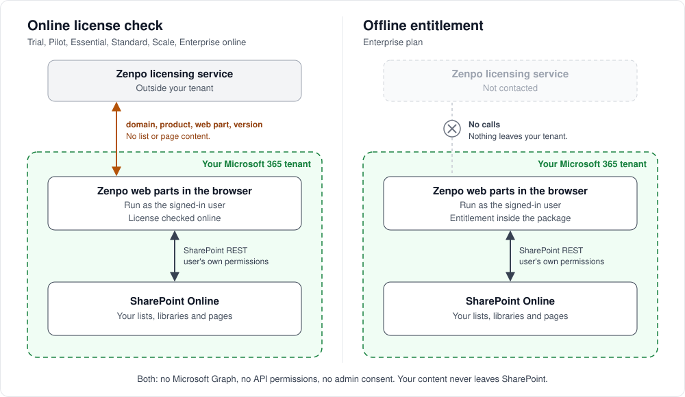

# Security and Data Handling

**Product:** Zenpo Intranet Suite for SharePoint
**Applies to:** v1.0.1.0, the current release
**Last reviewed:** 2026-10-27

This page covers what Zenpo Intranet Suite for SharePoint does in your tenant, what data
leaves it and what Zenpo keeps. It is intended for security, network and procurement
reviewers, with the details of permissions, licensing and card payments below.

---

## Summary

- The suite consists of 18 SharePoint Framework (SPFx) web parts running in the browser on
  SharePoint Online modern pages.
- Every SharePoint request runs as the signed-in user, with that person's permissions.
  Nothing elevates access.
- The package requests no API permissions: no Microsoft Graph, no admin consent and no
  app-only access.
- Your content stays in your SharePoint. Zenpo does not have a copy of your lists, libraries
  or pages.
- Zenpo does not track clicks, searches or who viewed which page.
- The web parts contact Zenpo only for licensing and when an editor clicks a subscription
  button to open the buy page. Neither sends your content.
- With Enterprise offline entitlement, there are no calls to Zenpo at all. See
  [Enterprise Plan](docs/enterprise-plan.md).

---

## What the suite does not need

Users sign in to Microsoft 365 as usual. They do not need to create a Zenpo account or use
a separate Zenpo login.

Your content remains in your SharePoint lists, libraries and pages. The web parts read it
through SharePoint's own REST API. No Zenpo backend reads, stores or serves that content,
and there is no custom database to maintain.

License checking is the one Zenpo service the web parts need to run, as described below.
With Enterprise offline entitlement, that dependency goes away as well. The web parts need
only your SharePoint.

---

## What is in the package

The package contains 18 web parts. There are no SharePoint Framework extensions: no
application customizers, field customizers or command sets.

Scripts, styles and images ship inside the `.sppkg` file and are served from your own
SharePoint. No scripts or styles load from Zenpo or a third-party CDN.
The package supports tenant-wide deployment from the app catalog.

Zenpo publishes a software bill of materials and build checksums for every release. See
[Release evidence](#release-evidence).

---

## How the web parts use SharePoint

**Reading.** A web part reads lists, libraries and pages through SharePoint REST as the
signed-in user. SharePoint applies that person's permissions to every read, so the web part
receives only the items that person is allowed to see. The images and links it displays
come from your own lists and pages.

Org Chart and People Directory read a SharePoint list or a CSV file you control. Neither
reads Microsoft Graph or Microsoft Entra ID.

**Writing.** The web parts write to SharePoint only when an author chooses a setup action.
Each write uses that author's own permissions:

- Create an optional starter list with sample rows. These are ordinary list items that the
  author can edit or delete.
- Install three page templates through Page Templates, along with a small setup file in the
  site's Site Assets library. Page Templates never changes, replaces or deletes an existing
  page.
- Upload images to the site's Site Assets library.

The web parts never write to SharePoint on behalf of viewers.

---

## Your governance applies

Because the content stays in your SharePoint, the controls you already have there apply:

- Your data-handling policies determine what may go into a list or library. The web parts
  display that content and add nothing to it.
- List and library content retains the versioning, retention, audit logging, sensitivity
  labels and eDiscovery configured in your tenant, just as any other list or library does.
- Banner, Simple Blurbs, Intranet Footer and Page Heading store their content in the page
  itself. It is saved, versioned and published with the page.
- Your SharePoint admin deploys the package from your app catalog and can remove it at any
  time. Removing the package leaves your lists, libraries and pages in place.

---

## What leaves your tenant



The following calls apply to the free trial, the Pilot, Essential, Standard and Scale
plans, and Enterprise with online licensing. The table lists when each call happens and
what it sends.

| Call | When it happens | What it includes |
|---|---|---|
| License check | When a web part loads, unless this browser received a license reply for your registered domain in the last 24 hours | SharePoint domain, product identifier, which Zenpo web part made the call and the installed package version. No page address or information about who is viewing |
| Registration | Once per tenant, when someone accepts the license terms in a web part's settings pane | SharePoint domain, product identifier, the email address of the person accepting, the number of users in the site collection, which web part, package version and a fixed source label |
| Trial extension | When an editor extends the trial from the settings pane | SharePoint domain, product identifier, which web part and a fixed source label |
| Subscription | When an editor clicks a buy, update, manage billing, cancel or renew button in the settings pane | The editor's email address, SharePoint domain, page address and subscription ID (if there is one) go to buy.zenpo.com. The buy page opens in a new tab |

As with any web request, the receiving service also sees the network address the request
comes from.

**What Zenpo keeps.** Zenpo keeps a license record for your domain and a log of the license
calls it receives. If you purchase online, Zenpo also keeps your subscription record.

**What the web parts do not send:**

- List items, documents, files and page content.
- Your users' names or email addresses, apart from the two email exceptions listed above:
  the person accepting the license terms and an editor opening a subscription page.
  The user count is calculated in the browser. Only the number is sent.
- Clicks, searches and who viewed which page.

### If the licensing service cannot be reached

These plans require access to the Zenpo licensing service. If a firewall blocks it, the web
part shows **Unable to reach licensing server**, unless this browser received a license
reply for your registered domain in the last 24 hours. This is an expected state with a
visible message; the web part does not fail silently. See
[License Messages Explained](https://help.zenpo.com/sharepoint-products/intranet-suite/licensing/license-messages/).

For tenants that cannot allow any outside call, Enterprise with offline entitlement removes
that requirement.

---

## Paying by card

Card payments take place outside SharePoint and the web parts. When an editor clicks a
buy, update, manage billing, cancel or renew button, a separate browser tab opens.

buy.zenpo.com prepares the purchase and directs the editor to Stripe. The editor enters
card details on Stripe's hosted checkout and billing pages at pay.zenpo.com. That address
uses Zenpo's domain, but it is a custom domain pointing to Stripe. Stripe hosts and operates
those pages.

The card details go directly from the browser to Stripe. They never pass through Zenpo's
servers, and Zenpo never sees or stores a card number. Stripe is certified as a PCI DSS
Level 1 Service Provider, the highest level.

Stripe notifies Zenpo when a subscription starts, changes or ends. Zenpo uses those
notifications to update the license.

---

## What is stored in the browser

- **License reply.** The last license reply is saved in the browser's local storage for
  24 hours. Local storage also holds a marker that your domain is registered.
- **List data.** To load faster, several list-driven web parts keep a copy of the items they
  display in the browser's local storage. Each copy is reused for a limited time before the
  web part reads the list again. In some web parts, the page author sets that interval.
  The copy stays on that device and is never sent to Zenpo.
- **Display state.** Small markers record which accordion sections are open, whether a
  banner video is paused and similar display choices.

---

## Release evidence

Each release has its own folder under [releases/](releases/) with the following evidence:

| File | What it is |
|---|---|
| `release-notes.md` | What changed in the release |
| `sbom.cdx.json` | Software bill of materials for the package (CycloneDX) |
| `checksums.txt` | SHA-256 hashes recorded by the build pipeline when it built the package |
| `build-metadata.json` | Version, build number, pipeline run, source commit and build date |

To check your package file, compute its SHA-256 hash and compare it with the `.sppkg` line
in that version's `checksums.txt`:

```text
macOS or Linux:   shasum -a 256 "Zenpo Intranet Suite for SharePoint.sppkg"
Windows:          Get-FileHash -Algorithm SHA256 "Zenpo Intranet Suite for SharePoint.sppkg"
```

Published release evidence stays as published. If a correction is needed, it ships as a
new release.

---

## Reporting a security issue

Email [support@zenpo.com](mailto:support@zenpo.com).

---

## Related pages

- [Enterprise Plan](docs/enterprise-plan.md)
- [Permissions and Data Access](https://help.zenpo.com/sharepoint-products/intranet-suite/permissions/)
- [Requirements and Supported Environments](https://help.zenpo.com/sharepoint-products/intranet-suite/requirements/)
- [License Agreement](https://intranet.zenpo.com/license-agreement)
